# 2026-10-21_技术-net-candidate-table-report

> 候选表与测速缺陷分析：为什么 218 个候选只看得到 80 个，为什么"超时 1 个"其实是 160 个

- **case_id**: `20261021-net-candidate-table`
- **scope**: [`work/20261021-net-candidate-table/scope.md`](../work/20261021-net-candidate-table/scope.md)
- **evidence**: [`work/20261021-net-candidate-table/evidence/`](../work/20261021-net-candidate-table/evidence/)（E-001…E-008，索引见 `INDEX.md`）
- **timeline**: [`work/20261021-net-candidate-table/timeline.md`](../work/20261021-net-candidate-table/timeline.md)
- **修复提交**: `efe6758 net control: list every candidate, and give every one a verdict`
- **受影响组件**: `oc-error-monitor/v1.2.0-dev`（开发版 8899）。生产 `v1.1.0`（8788）未受影响，见 E-007。

---

## 1. 摘要

面板的"策略组候选"表存在两个叠加缺陷，导致它**显示的节点不是能用的节点、测速的结论也不是测速的结论**：

1. 后端只把策略组的前 80 个成员发给前端，而组的自然顺序恰好把最快的节点排在后面（index 102 / 171 / 184），于是表里全是不通路的节点，真正值得切的节点根本看不见、也点不到。
2. 测速走 mihomo 的 `GET /group/<name>/delay`。该端点**只回答有响应的成员**，超时的成员被整体省略而不是标记为 timeout。于是"没测"和"已死"无法区分，面板报出"超时 1 个"，而实际超时的是 141 个。

修复后：218 个成员全部列出，216 个可测候选**逐个**打一次 opencode.ai，每个都有明确结论（延迟值，或"超时"）。

**修复带来的第一个实质结论**：一旦每个候选都有结论，按线路族一统计立刻看出，**216 个候选里有 96 个（44%）是结构性死节点**——`优选域名` 66 个与 `IPv6优选` 30 个在每一轮测速中都是 0 存活，而其余四族只有约 6% 的成员在两轮之间翻转。两个死族的原因都在代理之外，且互不相同（详见 F-005 / F-006）。而修复前的 80 行窗口里，**只有 9 个是活节点**（66 个 `优选域名` 全在里面），另外 53 个活节点被截断在窗口外。

---

## 2. Scope 摘要

| 项 | 值 |
|---|---|
| auth.status | granted（own_system：本机回环代理 + 用户自己的 Clash Verge 配置） |
| network_profile | authorized_target_only |
| in_scope.assets | `http://127.0.0.1:8899/__net`、`/__net/probe`、`http://127.0.0.1:8788/__health`、`http://127.0.0.1:9097/proxies` |
| out_of_scope | dos、phishing_real_users、unrestricted_exfil |
| ready_for_act | true |

分析对象是**用户自己机器上的本地代理与面板代码**，未触达任何第三方资产。

---

## 3. Evidence

| id | 观察 | source_ref | severity |
|---|---|---|---|
| [E-001](../work/20261021-net-candidate-table/evidence/E-001.md) | mihomo group delay 端点省略超时成员（5 次分别回 48/52/58/60/62 / 218） | command | high |
| [E-002](../work/20261021-net-candidate-table/evidence/E-002.md) | 后端 `[:80]` 截断 218 个成员 | file | high |
| [E-003](../work/20261021-net-candidate-table/evidence/E-003.md) | 订阅"优选"正则在 218 个节点上命中 0 个 | command | medium |
| [E-004](../work/20261021-net-candidate-table/evidence/E-004.md) | 逐节点探测 218 个：27.8s，53 通 / 165 超时 | command | info |
| [E-005](../work/20261021-net-candidate-table/evidence/E-005.md) | 回归测试在旧代码 FAILED(11) / 新代码 OK(11) | command | info |
| [E-006](../work/20261021-net-candidate-table/evidence/E-006.md) | 实机测速 216/216 全部有结论（75 通 / 141 超时，36s） | command | info |
| [E-007](../work/20261021-net-candidate-table/evidence/E-007.md) | 部署 dev 全程生产 8788 pid 7004 不变、uptime 增长、真实请求仍有上游响应 | command | info |
| [E-008](../work/20261021-net-candidate-table/evidence/E-008.md) | 页面实测 218 行 6 列、只显示可用 75 行、console 0 错误、切换成功 | screenshot | info |
| [E-009](../work/20261021-net-candidate-table/evidence/E-009.md) | 两个线路族在每一轮测速中 100% 全死（优选域名 66 + IPv6优选 30），其余族仅 ~6% 翻转 | command | high |
| [E-010](../work/20261021-net-candidate-table/evidence/E-010.md) | 两个死族的原因都在代理之外，且互不相同（ECH 握手失败 / IPv6 关闭且本机无 IPv6 出口） | command | high |

### 3.1 E-001 关键摘录

同一组、连续五次调用 `GET /group/<name>/delay?url=https://opencode.ai&timeout=N`：

```
timeout= 5000 -> returned  62 in   5.0s | alive  61 | marked-dead   1 | ABSENT 156
timeout=10000 -> returned  61 in  10.0s | alive  60 | marked-dead   1 | ABSENT 157
timeout=20000 -> returned  57 in  20.0s | alive  57 | marked-dead   0 | ABSENT 161
group members: 218
```

`marked-dead` 几乎恒为 0~1，而 `ABSENT` 稳定在 156~161：**超时的节点根本没进应答**，不是被标成超时。旧实现正是把这个应答当作全集，于是"测了 58 个、超时 1 个"。

### 3.2 E-002 关键摘录

```python
# oc-error-monitor/v1.2.0-dev/retry_proxy.py（修复前，第 728 行）
members = []
for name in (group_obj.get("all") or [])[:80]:
```

组的 `all` 顺序 = 嵌套主组 → `优选域名-01..N` → `多线/电信/移动/联通/IPv6优选` → `DIRECT`。实测最快的三个节点位于 index 102（多线-06）、171（电信-25）、184（联通-28），**全部落在截断之外**。

---

## 4. Findings

### F-001 候选表截断在 80，快节点全部不可见
- **severity**: high
- **category**: design
- **status**: validated
- **evidence_ids**: [E-002, E-008]
- **location**: `oc-error-monitor/v1.2.0-dev/retry_proxy.py:728`（修复前）
- **impact**: 面板把 218 个候选里最不通路的 80 个摆出来，最快的节点既看不见也点不到。用户据此判断"该走哪条线"会得到反向结论。
- **confidence**: high
- **remediation**: 不截断；成员全量下发，前端按"可用优先 → 实测延迟升序 → 未测 → 超时"排序，并提供"只显示可用"过滤。

### F-002 测速端点只回答成功者，超时被误读为未测
- **severity**: high
- **category**: design
- **status**: validated
- **evidence_ids**: [E-001, E-004, E-006]
- **location**: `oc-error-monitor/v1.2.0-dev/retry_proxy.py net_probe()`（修复前调用 `/group/{name}/delay`）
- **impact**: 测速结论系统性低估故障面——报"超时 1 个"时实际超时 141 个。候选节点的真实可用率被高估约 3 倍。
- **confidence**: high
- **remediation**: 改为逐节点 `GET /proxies/<name>/delay`，有界并发 16，后台线程执行并暴露进度；每个候选输出"延迟值"或"超时"。

### F-003 "优选/普通"列为死列
- **severity**: medium
- **category**: design
- **status**: validated
- **evidence_ids**: [E-003, E-008]
- **location**: `oc-error-monitor/v1.2.0-dev/retry_proxy.py preferred_re`
- **impact**: 正则取自用户自己的 Clash Verge `Script.js`，但本订阅节点名为 `优选域名-XX / 多线-XX / 电信-XX / 移动-XX / 联通-XX / IPv6优选-XX`，命中 0 个。该列恒显"普通"，"优选在前"排序是空操作，真正的线路差异（CF 前置的优选域名 vs 运营商中转）反而不可见。
- **confidence**: high
- **remediation**: 保留原正则（对其它订阅仍有效，正则命中时仍打"优选"徽标），同时按名称派生 `family`（优选域名/多线/电信/移动/联通/IPv6优选）作为"线路"列。

### F-004 不可单独测速的成员被混进候选池
- **severity**: low
- **category**: design
- **status**: validated
- **evidence_ids**: [E-004, E-006, E-008]
- **location**: `oc-error-monitor/v1.2.0-dev/retry_proxy.py net_snapshot()`
- **impact**: 嵌套策略组与 `DIRECT` 对 `/proxies/<name>/delay` 一律回 504。若不区分，它们会被算成"死节点"或"未测"，掩盖真实的故障分布。
- **confidence**: high
- **remediation**: 标记 `probeable=false`，前端显示"不可测"；测速分母按可测候选计。

### F-005 优选域名族 66 个节点结构性全死（ECH 握手无法完成）
- **severity**: high
- **category**: misconfig
- **status**: validated
- **evidence_ids**: [E-009, E-010]
- **location**: Clash Verge profile `R7eLZqdrmmaV.yaml`（节点 `ech-opts` 段）
- **impact**: 该族 66 个节点在**每一轮**测速中 0 存活。它们的名字带"优选"，是订阅作者最想让你用的那一批，但在本机一个都连不上。机制：全部节点都开了 `ech-opts.enable=true` + `query-server-name: cloudflare-ech.com`，而这些是 Cloudflare 的 ECH 专用主机名——TLS 握手**只有在使用节点自己的 SNI 时才失败**，同一个 IP 换 SNI 就成功（`bestcf.top` SNI=bestcf.top → `SSLV3_ALERT_HANDSHAKE_FAILURE`，SNI=www.cloudflare.com → TLS ok）。mihomo 对它们一律回 504。另有 22 个唯一 server 主机名中 9 个连 DNS 都解析不出来。
- **confidence**: high
- **remediation**: 由订阅/客户端侧解决——需要能完成 ECH 握手的 mihomo 版本与 DNS 路径；本代理侧只能如实标出"超时"。

### F-006 IPv6优选族 30 个节点结构性全死（IPv6 被关且本机无 IPv6 出口）
- **severity**: high
- **category**: misconfig
- **status**: validated
- **evidence_ids**: [E-009, E-010]
- **location**: 用户自己的 Clash Verge 脚本 `Script.js`（`config.ipv6 = false`）与本机 IPv6 出口
- **impact**: 该族 30 个节点在每一轮测速中 0 存活。两个独立原因叠加：① 用户脚本第 75/78 行写死 `config.ipv6 = false`（运行中 mihomo `/configs` 确认 `ipv6 = False`），而这些节点的 server 全是 IPv6 字面量；② 即便打开，本机也没有可用的公网 IPv6 出口——从操作系统直连 Cloudflare 自己的 `2606:4700:4700::1111` 也超时。mihomo 对它们回 503（连接错误，非超时）。
- **confidence**: high
- **remediation**: 属用户主动配置（脚本注释写明"防止本地运营商 IPv6 抢跑泄漏"）与本机网络条件，**未擅自改动线上 mihomo 的 ipv6 开关**（生产 8788 共用同一代理路径）。若要启用需同时满足 mihomo 开启 IPv6 与本机具备可用 IPv6 出口。

---

## 5. 线路族健康度（修复带来的新结论）

每个候选都有了结论之后，按线路族一统计，立刻能看出"哪些族根本用不了"：

| 线路族 | 候选数 | 存活（两轮） | 状态 | 原因 |
|---|---|---|---|---|
| 优选域名 | 66 | **0 / 0** | 结构性全死 | ECH 专用主机名，握手无法完成（F-005） |
| IPv6优选 | 30 | **0 / 0** | 结构性全死 | `ipv6=false` + 本机无 IPv6 出口（F-006） |
| 移动 | 30 | 20 / 19 | 正常波动 | — |
| 联通 | 30 | 15 / 18 | 正常波动 | — |
| 电信 | 30 | 11 / 13 | 正常波动 | — |
| 多线 | 30 | 11 / 12 | 正常波动 | — |

两轮全量测速之间，**只有 6.0%（13/216）的节点发生状态翻转**——所以两个全死族是结构性的，不是运气差。

对照修复前的 80 行窗口（组顺序前 80）：

| 窗口 | 成员数 | 活节点 |
|---|---|---|
| 旧表显示的前 80 | 80 | **9**（其中 66 个是全死的优选域名） |
| 被 `[:80]` 截断隐藏的 | 138 | **53** |
| 全量可测候选 | 216 | 62 |

**旧面板把 71 个死节点摆在明面上，却把 53 个活节点藏了起来。** 这正是"选线"功能失效的实质原因。

---

## 6. Path

### P-001 候选可见性到选线的调用路径
- **path_type**: callflow
- **start**: 用户在"网络"视图点"测速全部候选"，想找出当前最该走的那条线
- **goal**: 得到一份每个候选都有明确结论的清单，并从清单里切到最快的那条
- **steps**:
  1. action: 前端请求 `/__net` 取得成员清单 — evidence: E-002 — finding: F-001
     - 修复前：后端 `[:80]` 截断，最快节点（index 102/171/184）不在清单里，用户无从选择
  2. action: 前端请求 `/__net/probe?start=1` 启动测速并轮询进度 — evidence: E-001 — finding: F-002
     - 修复前：走 `/group/<name>/delay`，156~161 个超时成员被省略，面板报"超时 1 个"
  3. action: 后端逐个打 `/proxies/<name>/delay`（并发 16，216 个候选 36s） — evidence: E-004, E-006 — finding: F-002
     - 每个候选落成"延迟值"或"超时"；`alive + dead == 216`，不再有"没测"这种状态
  4. action: 前端按可用优先/延迟升序渲染 218 行，并标出"优选域名/多线/电信"等线路族 — evidence: E-003, E-008 — finding: F-003
  5. action: 用户点"切换" → `PUT /proxies/<group>` → 页面回显新链路 — evidence: E-008 — finding: F-001
     - 实测：多线-06 → 多线-26，链路 `🎯 OpenCode专用→多线-26`，381ms
- **residual_risks**:
  - 216 个候选逐个打一次 opencode.ai，会产生 216 次真实请求；已限并发 16，且节点大多在 5s 内超时。频繁点测速会重复消耗。
  - 面板给出的是**当时**的延迟，不是持续健康度；节点可能在两次测速之间变化。

### P-002 数据流

```mermaid
flowchart TD
    subgraph BEFORE["修复前"]
        A1["面板点测速"] --> B1["GET /group/NAME/delay<br/>只回答有响应的成员"]
        B1 --> C1["tested=58 / dead=1<br/>160 个超时被省略"]
        C1 --> D1["表里 80 个成员<br/>快的在 index 102+"]
    end

    subgraph AFTER["修复后"]
        A2["面板点测速"] --> B2["POST /__net/probe?start=1<br/>后台线程"]
        B2 --> C2["逐个 GET /proxies/NAME/delay<br/>并发 16"]
        C2 --> D2["每候选: 延迟值 或 超时<br/>alive+dead == 216"]
        D2 --> E2["218 行全量表<br/>可用优先 · 只显示可用"]
        E2 --> F2["切换: PUT /proxies/GROUP<br/>实测 多线-06 → 多线-26 381ms"]
    end

    style C1 fill:#5a1f1f,stroke:#f85149,color:#fff
    style D1 fill:#5a1f1f,stroke:#f85149,color:#fff
    style D2 fill:#1f3d2a,stroke:#3fb950,color:#fff
    style F2 fill:#1f3d2a,stroke:#3fb950,color:#fff
```



---

## 7. Timeline 摘要

| 时间 | 阶段 | 结果 |
|---|---|---|
| 03:2x–03:5x | 根因取证 | 5 次 group/delay 采样 → 端点省略超时成员（E-001）；逐节点对照 218 个 → 53 通 / 165 超时（E-004） |
| 04:0x | 定位截断 | 确认 `[:80]` 与组自然顺序的叠加效应（E-002）；优选正则命中 0（E-003） |
| 04:1x | 红绿测试 | 新测试在旧代码 11 errors / 新代码 11 OK（E-005） |
| 04:1x | 实施 | 后端逐节点测速 + 全量成员 + family；前端 218 行 6 列 + 只显示可用 + 进度轮询 |
| 04:2x | 部署 | 仅 dev：生产 pid 7004 不变、uptime 增长、真实请求仍有上游响应（E-007） |
| 04:2x | 实测 | 216/216 有结论，75 通 / 141 超时，最快 多线-26 381ms（E-006） |
| 04:2x | 页面验收 | 218 行、过滤 75 行、console 0 错误、切换成功（E-008） |
| 04:3x | 线路族统计 | 每个候选都有结论后才能按族汇总：优选域名 66 与 IPv6优选 30 **每轮 0 存活**，其余族两轮仅 6% 翻转（E-009） |
| 04:4x | 死因定位 | 优选域名：ECH 主机名握手失败（换 SNI 即成功）；IPv6优选：`ipv6=false` + 本机无公网 IPv6 出口（E-010）。**未改动线上 mihomo 的 ipv6 开关** |

---

## 8. 修复内容

**后端** `oc-error-monitor/v1.2.0-dev/retry_proxy.py`
- `net_snapshot()`：成员全量下发（去 `[:80]`），新增 `family` / `measured` / `measured_delay` / `dead` / `probeable`，并把上次测速结果合并进成员。
- `net_probe()`：改为逐节点 `/proxies/<name>/delay`，有界并发 16，后台线程执行；`GET /__net/probe?start=1` 启动，`?start=0` 只读进度（轮询不会重启正在跑的任务）。
- `_node_family()`：按名称派生线路族；原"优选"正则保留，命中时仍打"优选"徽标。
- 不可单独测速的成员（嵌套组、`DIRECT`）标 `probeable=false`，不再伪装成超时。

**前端** `oc-error-monitor/v1.2.0-dev/ui.html`
- 候选表改为 6 列（节点 / 线路 / 类型 / 延迟 / 状态 / 操作），渲染全部 218 行。
- 排序：可用优先 → 实测延迟升序 → 未测 → 超时；新增"只显示可用"过滤。
- 测速按钮改为"启动 + 轮询进度"，不再让浏览器干等 30 秒。

**测试** `oc-error-monitor/v1.2.0-dev/test_net_candidates.py`（新增，11 例）
- 断言 218 个成员全部列出、index 102/171 的节点在列、超时节点报"死"而非"缺失"、group delay 端点不再被调用。

---

## 9. 验证

```powershell
cd "D:\Project\Openchamber\Opencode网络\oc-error-monitor\v1.2.0-dev"

# 回归测试（红：旧代码 11 errors；绿：新代码 11 OK）
python test_net_candidates.py

# 实机测速
Invoke-RestMethod 'http://127.0.0.1:8899/__net/probe?timeout=5000&start=1'
Invoke-RestMethod 'http://127.0.0.1:8899/__net/probe?start=0'   # alive+dead == total

# 生产未受影响
Invoke-RestMethod 'http://127.0.0.1:8788/__health'               # pid 7004，uptime 持续增长
```

实测输出：

```
Ran 11 tests in 0.092s
OK
tested=216 alive=75 dead=141 total=216  elapsed=36s
every candidate has a verdict: True
fastest 6: 多线-26=381ms, 电信-25=407ms, 联通-08=413ms, 联通-27=431ms, 联通-07=437ms, 多线-06=447ms
prod pid=7004 up=2470.9
prod upstream answered: HTTP 404 (404 = upstream replied, chain alive)
```

浏览器侧：候选表 218 行、"只显示可用"过滤到 75 行、console 0 错误；点"切换"后 toast "已切换到 多线-26"，链路 `🎯 OpenCode专用→多线-26` 381ms。

---

## 10. 遗留

- `🚀 节点选择`（嵌套策略组）与 `DIRECT` 无法单独测速：mihomo 对二者的 `/proxies/<name>/delay` 一律回 504。面板标为"不可测"而非伪装成超时（见 F-004）。
- 测速是**瞬时**延迟，不代表持续健康度；面板的"延迟历史"沿用 mihomo 自带 history。
- 每次全量测速会对 opencode.ai 发起 216 次真实请求。已限并发，但频繁重复测速仍有额外开销。
- **`优选域名` 族 66 个节点在本机结构性不可用**（F-005）：需要能完成 ECH 握手的客户端与 DNS 路径，代理侧无法修复，只能如实标为超时。
- **`IPv6优选` 族 30 个节点在本机结构性不可用**（F-006）：需同时打开 mihomo 的 IPv6 并具备可用公网 IPv6 出口。用户的 Clash 脚本是**故意**关闭 IPv6 的，故未擅自改动线上开关——是否启用由用户决定。

---

## 11. 附件

| 文件 | 说明 |
|---|---|
| `oc-error-monitor/v1.2.0-dev/retry_proxy.py` | 后端修复（逐节点测速、全量成员、family、probeable） |
| `oc-error-monitor/v1.2.0-dev/ui.html` | 前端修复（6 列表格、只显示可用、进度轮询） |
| `oc-error-monitor/v1.2.0-dev/test_net_candidates.py` | 回归测试 11 例 |
| `oc-error-monitor/docs/net-candidate-table-fix.md` | 修复计划与验收表 |
| `work/20261021-net-candidate-table/evidence/` | E-001…E-010 原始证据 |
| `work/20261021-net-candidate-table/report/net-candidates-fixed.png` | 页面验收截图（候选表 218 行，含"当前"节点） |
